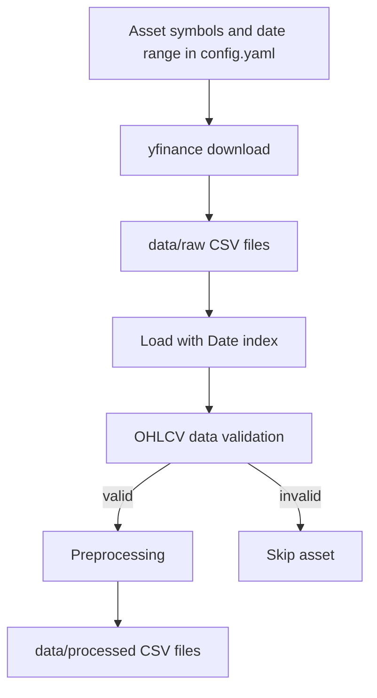

# FinSight AI — Multi-Asset Market Data & Risk Analytics

FinSight AI is an early-stage Python project for collecting, validating, and preprocessing historical market data for the S&P 500, NIFTY 50, gold, and Bitcoin. The repository also contains prepared feature CSVs and starter modules for future forecasting, risk, portfolio, and monitoring work.

**Current implementation status:** the market-data ETL path is partially implemented. Forecasting, risk evaluation, feature-store, dashboard, API, and application entry points are incomplete or empty in the current repository. This is not yet a complete financial intelligence application.

## Scope and Configured Assets

The configuration in `configs/config.yaml` defines:

| Asset key | Configured ticker |
|---|---|
| S&P 500 | `^GSPC` |
| NIFTY 50 | `^NSEI` |
| Gold | `GLD` |
| Bitcoin | `BTC-USD` |

The configured data start date is `2018-01-01`. The configuration also contains a seven-step forecast horizon and a local database host setting; a database-backed workflow is not currently implemented.

## Implemented Workflow

The current ETL path is organized around the following steps:

1. **Download:** `src/ingestion/download_market_data.py` uses yfinance to download configured assets and writes CSVs under `data/raw/`.
2. **Load:** `src/ingestion/load_data.py` reads raw CSVs and parses `Date` as the index.
3. **Validate:** `src/validation/validation.py` checks required OHLCV columns, missing values, duplicate rows/dates, future dates, negative volume, invalid prices, and numeric data types.
4. **Preprocess:** `src/preprocessing/preprocess.py` removes duplicate rows, sorts by date, forward/back-fills missing values, filters selected invalid rows, normalizes column names, and writes processed CSVs under `data/processed/`.
5. **Orchestrate:** `src/ingestion/pipeline.py` downloads the configured assets and runs the validation/preprocessing steps asset by asset.



The existing CSV files under `data/features/` are committed feature datasets. They are separate from the raw/processed paths used by the current ETL code; the current pipeline does not build or consume those feature files.

## Repository Structure

```text
.
├── configs/
│   ├── config.yaml
│   └── paths.py
├── data/
│   └── features/
│       ├── bitcoin_features.csv
│       ├── gold_features.csv
│       ├── nifty50_features.csv
│       └── sp500_features.csv
├── notebooks/
├── src/
│   ├── ingestion/       # yfinance download, loading, ETL orchestration
│   ├── validation/      # OHLCV data-quality checks
│   ├── preprocessing/  # cleaning and processed CSV output
│   ├── feature_store/  # currently empty implementation file
│   ├── forecasting/    # currently empty implementation file
│   ├── risk/            # currently empty implementation file
│   ├── evaluation/      # currently empty implementation file
│   ├── alerts/
│   ├── api/
│   ├── dashboard/
│   ├── explainability/
│   ├── monitoring/
│   ├── portfolio/
│   ├── regime_detection/
│   ├── technical_indicators/
│   └── utils/
├── tests/
├── app.py              # empty placeholder
├── train.py            # empty placeholder
├── predict.py          # empty placeholder
├── Dockerfile          # empty placeholder
└── requirements.txt
```

## Setup

The repository pins Python package versions in `requirements.txt`.

```bash
git clone https://github.com/saidattaputta/FinSight-AI.git
cd FinSight-AI
python -m venv .venv
source .venv/bin/activate  # Windows: .venv\\Scripts\\activate
pip install -r requirements.txt
```

The ETL orchestrator is `src/ingestion/pipeline.py`. It downloads external market data and writes files into `data/raw/` and `data/processed/`; review those paths and preserve any local data before running it. The pipeline has not been executed as part of this README review.

## Current Gaps and Validation Notes

- The root `app.py`, `train.py`, `predict.py`, and `Dockerfile` are empty in the current tracked tree.
- `src/feature_store/build_features.py`, `src/forecasting/train_models.py`, `src/risk/risk_metrics.py`, and `src/evaluation/evaluate.py` are empty.
- The `tests/` directory contains only an empty package initializer; no executable test suite was found in the tracked tree.
- The configured `data.raw` / `data.processed` values and the ETL modules' paths should be kept aligned as the project evolves.
- The committed `data/features/` exports are not generated by the current ETL orchestrator.
- Market data retrieval requires network access and may return revised or incomplete historical data.

## Recommended Next Work

Complete and validate feature engineering, time-series forecasting, risk metrics, evaluation, and monitoring modules; add non-destructive automated tests; connect the committed feature exports to a reproducible pipeline; and define explicit time-based validation and benchmark baselines before reporting predictive performance.

---

**Sai Datta Putta**

[LinkedIn](https://www.linkedin.com/in/sai-datta-putta/)
